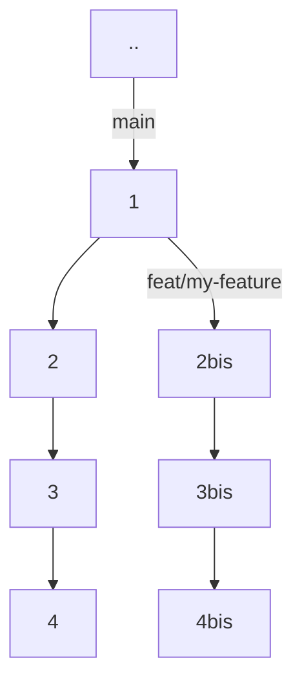
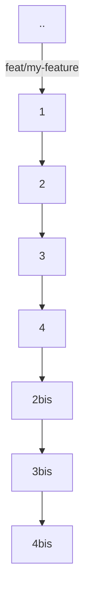

# Developer readme

## Development workflow

### Release policy

The development team works on a branch named _main_.

Whenever a feature needs to be implemented, a new branch (feat/<new_branch>) must be pulled from
_main_ and rebased to this later once the feature is ready.



Then, we will approve your changes and we will push these changes to main.

Depending on which improvements you will bring to the plugin,
you will have to choose the right gitmoji in your PR name in order to publish a new version.



Explanations:

> Before each new feature, run:
>
> ```bash
> git checkout main
> git pull
> ```
>
> Create a new branch feat/\<branch name\> for the feature
>
> ```bash
> git checkout -b feat/<branch name>
> ```
>
> Once the feature is implemented, create a pull request to get the approval of a reviewer. If it's approved, your feature will be squash and merge _feat/\<branch name\>_ to _main_.
>
>See contributing rules [here](./CONTRIBUTING.md).
>
> /!\ Don't forget to pull the updated pom.xml once the release job is done. /!\
>
> ```bash
> git pull
> ```
