# How can I contribute to Candy-doc project ?

First of all, all the team thank you for taking the time to contribute! 😻

We are really happy that you join the community, and we hope you'll enjoy working on this project.

In order to provide the most convenient collaboration, here is a tutorial and some directives to follow.

<!-- START doctoc generated TOC please keep comment here to allow auto update -->
<!-- DON'T EDIT THIS SECTION, INSTEAD RE-RUN doctoc TO UPDATE -->
## Table of Contents

- [Fix bugs and new features by creating PR's](#fix-bugs-and-new-features-by-creating-prs)
  - [1. Discussing the bug or the new feature](#1-discussing-the-bug-or-the-new-feature)
  - [2. Fork repository](#2-fork-repository)
  - [3. Clone repository](#3-clone-repository)
  - [4. Create a branch](#4-create-a-branch)
  - [5. Commits](#5-commits)
  - [6. Create a pull request](#6-create-a-pull-request)
- [TLDR](#tldr)
- [How to set your PGP key](#how-to-set-your-pgp-key)
  - [**Linux**](#linux)
  - [**Windows**](#windows)
    - [Requirements](#requirements)
    - [Steps](#steps)
      - [1. Run the **GPG4Win.exe** program](#1-run-the-gpg4winexe-program)
      - [2. Create a new key](#2-create-a-new-key)
      - [3. Add your name, email address and (optional) password](#3-add-your-name-email-address-and-optional-password)
      - [4. In advanced settings, be sure to have RSA selected with a key size of 4096 bits](#4-in-advanced-settings-be-sure-to-have-rsa-selected-with-a-key-size-of-4096-bits)
      - [5. Click **Ok** and **Create**](#5-click-ok-and-create)
      - [6. Enter your password when prompted](#6-enter-your-password-when-prompted)
      - [7. Double-click the key you just created](#7-double-click-the-key-you-just-created)
      - [8. Click **Export**](#8-click-export)
      - [9. Copy the key to your clipboard](#9-copy-the-key-to-your-clipboard)
      - [10. Paste the key into your GitHub account](#10-paste-the-key-into-your-github-account)

<!-- END doctoc generated TOC please keep comment here to allow auto update -->

## Fix bugs and new features by creating PR's

If you're already used to contribute to open source project, please go to the [**_TLDR_**](#tldr) section.

If you're still here, it means you likely never or barely contribute to an open-source project.

No shame ! We all get through this. Lucky you, here's the basics that I would have liked to know when I started.

Some parts are inspired by [_first-contributions_](https://github.com/firstcontributions/first-contributions) GitHub.

### 1. Discussing the bug or the new feature

If you want to contribute, you may have some new features to propose or bugs you want to fix.

**_However, you need to open a discussion first._**

- First, go to the `Issues` tab

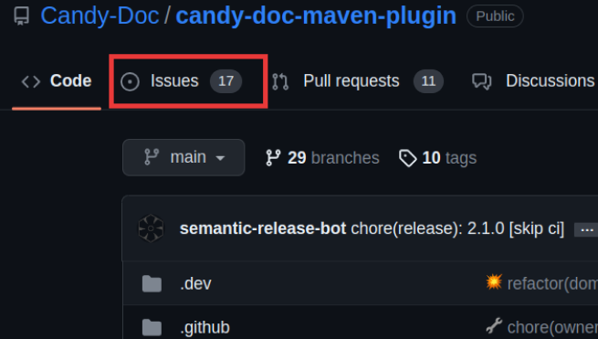

- Then create an issue

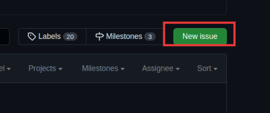

- Then choose either you're reporting a bug or proposing a new feature
- Finally, follow the instructions and submit the new issue

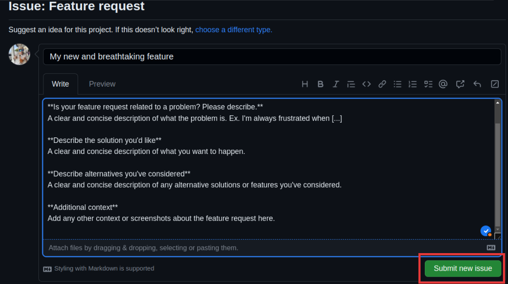

This will open a discussion with the project members. Once your issue is approved, you can go ahead.

### 2. Fork repository

**_Now, the issue is approved, you can fork the project._**

When you fork a project, you create an independent copy of the entire project.

Forking allows you to contribute to an existing project without directly modifying the original codebase. You can make changes, add features, or fix issues in your forked repository.

To fork this repository click on the _**Fork**_ button in the top-right corner of this page.

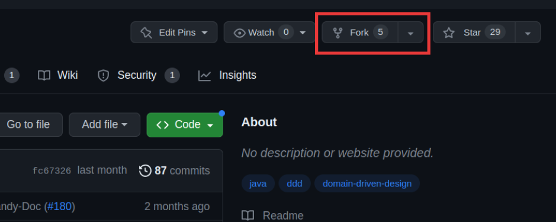

### 3. Clone repository

**_Now, you'll clone the forked project._**

When you clone a project, you create a local copy on your own machine.

To clone, go to the Github repository, click one **_<> Code_**, then click on the copy button.

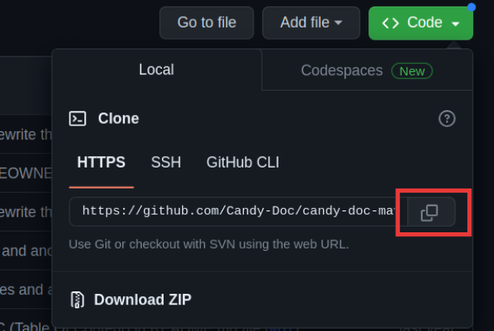

Then, open a terminal, go to the directory when you want to clone the project and use the following command :

```bash
git clone the_url_you_copied
```

### 4. Create a branch

**_Now create the branch on which you'll work on._**

Git branches are used to isolate and organize different lines of development within a repository. They allow you to work on multiple independent features, bug fixes, or experiments simultaneously without interfering with each other.

Therefore, you'll create your own branch with the following convention :

- First, check that you create a branch from main since this is the up-to-date branch You can use

```bash
git branch
```

- Then, if you're working on a new feature

```bash
git switch --create feat/your-feature
```

- If you're fixing an issue

```bash
git switch --create fix/the-issue
```

### 5. Commits

**_You can now safely, contribute to project on your favorite IDE_**

Please make sure to keep commits **_small_** and **_relevant_** by following our [**_git commit message convention_**](COMMIT_MESSAGE_CONVENTION.md).

### 6. Create a pull request

**_Once you committed all the changes, create a pull request against the main branch_**

- First, make sure you pushed your commits on your branch.

- Then, go to `Pull requests` tab.

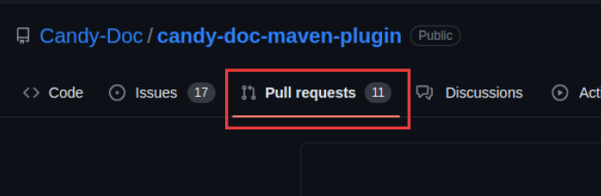

- A GitHub message should appear and propose you to create a pull request. Click on ```Compare & pull request```.

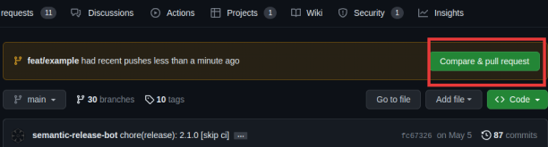

- Finally, follow the instructions and submit create the pull request.

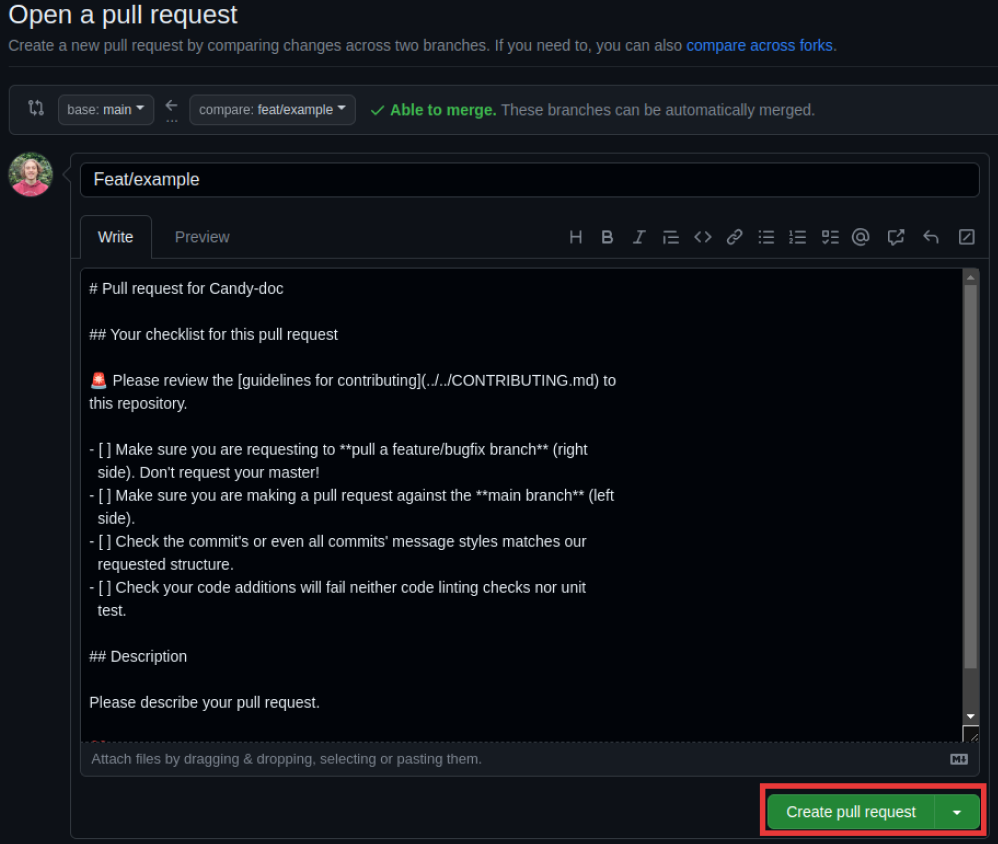

Once the pull request is created, we're checking what you've done, making comments and may request some changes.

Once the pull request is approved, we're merging your contribution to our main branch.

You will get a notification email once the changes have been merged.

Well done, you **_successfully contributed to Candy-doc_** !

## TLDR

We appreciate every time you report a bug in the product. However, taking time to submit a PR can help us in fixing bugs quickly and ensure a healthy and stable eco-system.

Go through the following points, before creating a new PR.

1. Create an issue discussing the bug.
2. Once approved, go ahead and fork the REPO.
3. Make sure to start from the `main`, since this is the up-to-date branch.
4. Make sure to keep commits small and relevant.
5. Follow [our git commit message convention](COMMIT_MESSAGE_CONVENTION.md).
6. Once done with all the changes, create a PR against the `main` branch.

## How to set your PGP key

### **Linux**

Follow steps [**_here_**](https://docs.github.com/en/authentication/managing-commit-signature-verification/generating-a-new-gpg-key)

### **Windows**

#### Requirements

- [GPG4Win.exe](https://www.gpg4win.org/downloads/gpg4win.exe)
- GitHub Account

#### Steps

##### 1. Run the **GPG4Win.exe** program

##### 2. Create a new key

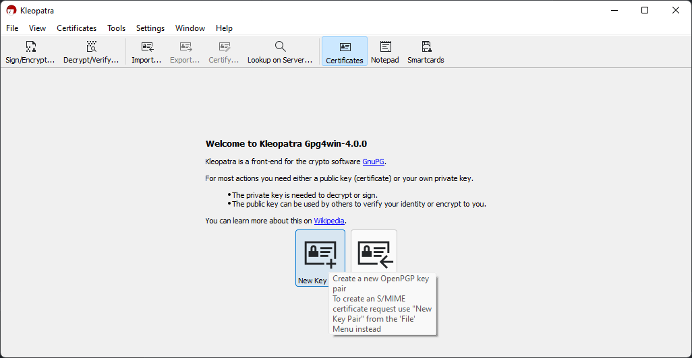

##### 3. Add your name, email address and (optional) password

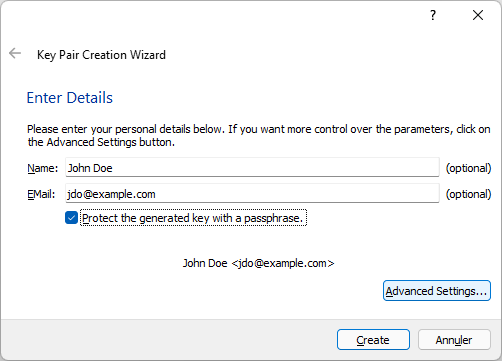

##### 4. In advanced settings, be sure to have RSA selected with a key size of 4096 bits

##### 5. Click **Ok** and **Create**

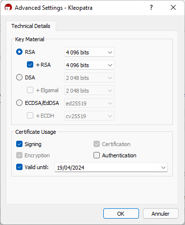

##### 6. Enter your password when prompted

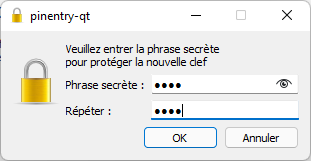

##### 7. Double-click the key you just created

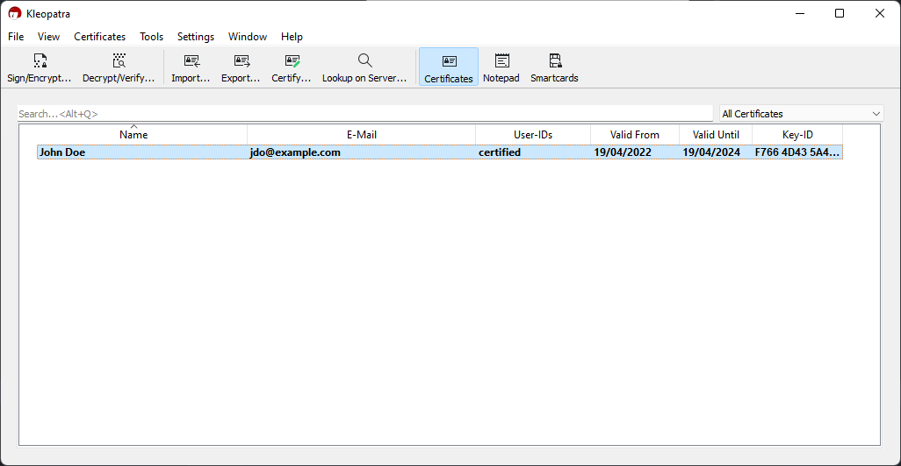

##### 8. Click **Export**

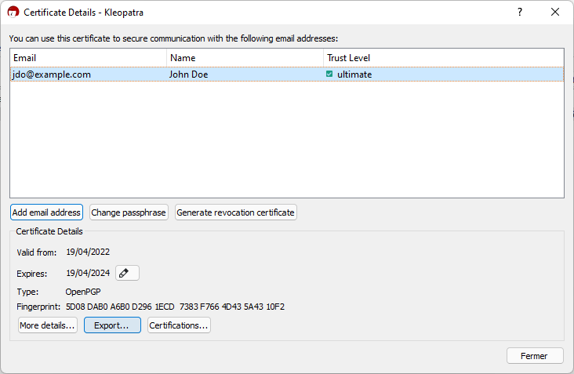

##### 9. Copy the key to your clipboard

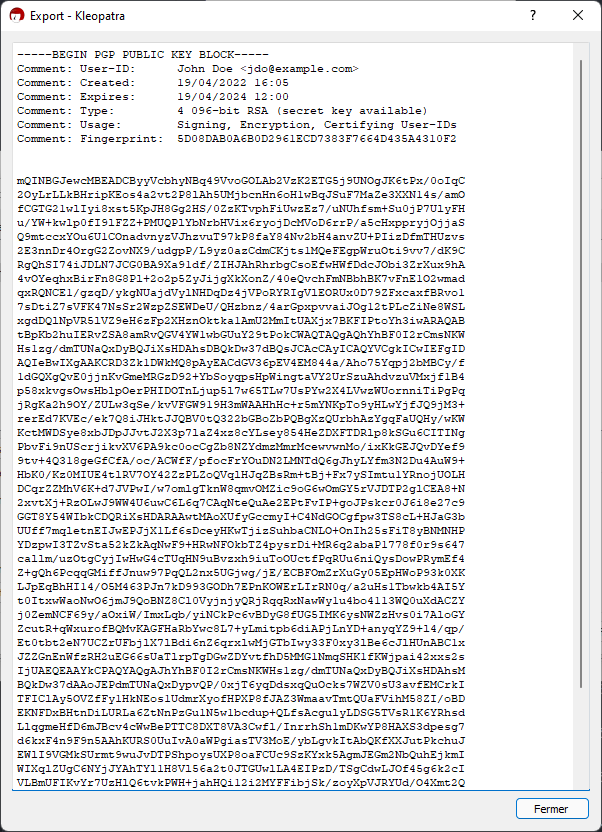

##### 10. Paste the key into your [GitHub account](https://github.com/settings/keys)

Congratulations! You have successfully set up your PGP key. :)
