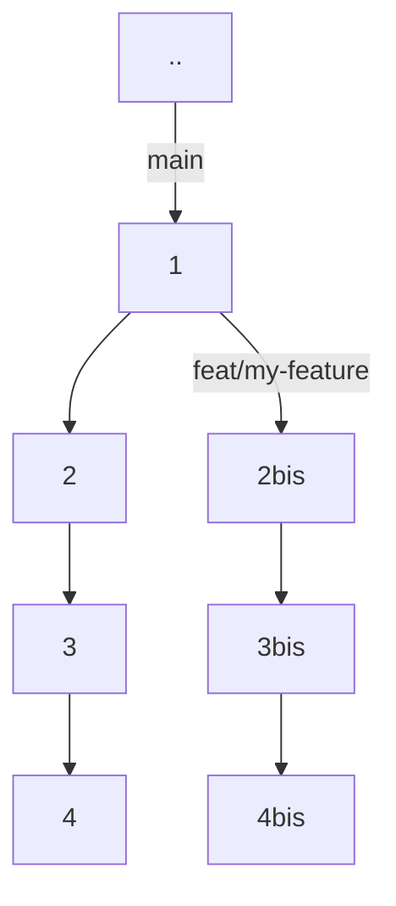
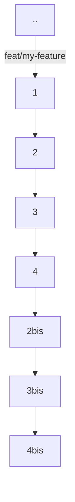

<h1 align="center">
  <picture>
    <source media="(prefers-color-scheme: dark)" width="242" height="90" alt="CandyDoc logo" srcset="https://user-images.githubusercontent.com/22562938/170952295-d5634b7d-54bf-4beb-a105-50123b29a15b.png">
    <source media="(prefers-color-scheme: light)"width="242" height="90" alt="CandyDoc logo" srcset="https://user-images.githubusercontent.com/22562938/170952293-a3d745d2-c61d-4094-82dd-0e04ea3e0efb.png">
    
  </picture>
  <p>Candy Doc Maven plugin</p>
</h1>

<p align="center">
  <a href="https://mvnrepository.com/artifact/io.candy-doc/candy-doc">
    
  </a>
  <a href="https://github.com/Candy-Doc/candy-doc-components-library/blob/main/LICENSE" alt="License">
    
  </a>
  <a href="https://discord.com/invite/CxwdeKjtcT" alt="Discord link">
    
  </a>
</p>

Candy Doc is a documentation generator plugin for projects built with the
Domain-Driven-Design approach.

> _"Domain-Driven Design is an approach to software development that centers
> the development on programming
> a domain model that has a rich understanding
> of the processes and rules of a domain."_ - Martin Fowler
> [See more](#References)

<!-- START doctoc generated TOC please keep comment here to allow auto update -->
<!-- DON'T EDIT THIS SECTION, INSTEAD RE-RUN doctoc TO UPDATE -->
## Table of Contents

- [Installation](#installation)
  - [With Maven](#with-maven)
- [DDD Annotations](#ddd-annotations)
  - [Strategic patterns](#strategic-patterns)
    - [Bounded Context](#bounded-context)
    - [Shared Kernel](#shared-kernel)
    - [Nested context](#nested-context)
  - [Tactical patterns](#tactical-patterns)
    - [Aggregate](#aggregate)
    - [Domain Command](#domain-command)
    - [Domain Event](#domain-event)
    - [Value Object](#value-object)
- [ROADMAP 🗺️](#roadmap-)
- [&#91;FOR DEV&#93; Development workflow](#for-dev-development-workflow)
  - [Release policy](#release-policy)
- [References](#references)
- [Join us 🙋](#join-us-)
- [Contributors ✨](#contributors-)

<!-- END doctoc generated TOC please keep comment here to allow auto update -->

## Installation

### With Maven

To run this plugin, import the following:

```xml

<dependency>
    <groupId>io.candy-doc</groupId>
    <artifactId>candy-doc</artifactId>
    <version>${candy-doc.version}</version>
</dependency>

<plugin>
<groupId>io.candy-doc</groupId>
<artifactId>candy-doc</artifactId>
<version>${candy-doc.version}</version>
<executions>
    <execution>
        <goals>
            <goal>ubiquitous-language</goal>
        </goals>
    </execution>
</executions>
<configuration>
    <packagesToScan>
        <packageToScan>com.foo.bar</packageToScan>
    </packagesToScan>
    <outputFormat>html</outputFormat>
</configuration>
</plugin>
```

Then, specify the configuration parameters:

**packagesToScan:** The chosen packages to scan to generate a documentation for.

Example:

```xml

<packagesToScan>
    <packageToScan>com.foo.bar.baz</packageToScan>
    <packageToScan>com.foo.qux</packageToScan>
</packagesToScan>
```

**outputFormat:** The output format in which the documentation is generated.
Output format can be either `json` or `yml`.

Once your project is correctly annotated with
the [DDD Annotations](#DDD_Annotations), use mvn to run the plugin (replace `${candy-doc.version}` with the current version you are using):

`mvn io.candy-doc:candy-doc:${candy-doc.version}:candy-doc`

The documentation will be generated in the `target/candy-doc` directory.

## DDD Annotations

Domain-Driven-Design concepts are identified with annotations.

### Strategic patterns

#### Bounded Context

```java
@BoundedContext(name = "", description = "")
```

Set of elements (classes, services, etc) containing only what is needed in a
specific context.

Only `package-info.java` files can be annotated with `@BoundedContext`. Every
other concepts must be inside a bounded context.

#### Shared Kernel

```java
@SharedKernel(name = "", description = "")
```

Set of elements (classes, services, etc) containing only what is needed in a specific context.
A shared kernel is the intersection of two bounded contexts (same DDD concepts used in each one).
It is often used to describe the relationship between two (or more) teams that share a small but common model.
It can only contain value objects.

Only `package-info.java` files can be annotated with `@SharedKernel`.
They work like bounded context do.

#### Nested context

Nested bounded contexts or nested shared kernels are forbidden and prevented by the plugin when processing classes.

### Tactical patterns

#### Aggregate

```java
@Aggregate(name = "", description = "")
```

Cluster of domain objects that can be treated as a single unit. It has an
identity and a lifetime.

An aggregate contains the domain logic and is aware of framework issues.

It is accessed by commands, returns events and deals with value objects.

Value objects in an aggregate are usually seen as Domain entities. This is the
only domain model that can be mutable.

#### Domain Command

```java
@DomainCommand(description = "")
```

A command is the entry point to perform a business logic from an aggregate.

It should use primitives only (and could use value objects) and is performed on
an aggregate.

#### Domain Event

```java
@DomainEvent(description = "")
```

Captures the memory of something interesting which affects the domain. It
usually starts with a verb in the past tense.

An event should always stay dumb and only carry static information.

Moreover, domain events cannot use strong domain concepts as domain logic should
never be used outside the domain.

#### Value Object

```java
@ValueObject(description = "")
```

An object that has no identity, no lifetime and who is compared based on his
values.

A Core Concept can interact with one or more value objects. A Value Object only
has primitive fields, is immutable and should be valid when instantiated.

## ROADMAP 🗺️

To know on what the team are actually working on, you can see the different
milestones [here](https://github.com/Candy-Doc/candy-doc-maven-plugin/milestones)

## [FOR DEV] Development workflow

### Release policy

The development team works on a branch named _main_.

Whenever a feature needs to be implemented, a new branch (feat/<new_branch>) must be pulled from
_main_ and rebased to this later once the feature is ready.



Then, we will approve your changes and we will push these changes to main.

Depending on which improvements you will bring to the plugin,
you will have to choose the right gitmoji in your PR name in order to publish a new version.



Explanations:

> Before each new feature, run:
>
> ```bash
> git checkout main
> git pull
> ```
>
> Create a new branch feat/\<branch name\> for the feature
>
> ```bash
> git checkout -b feat/<branch name>
> ```
>
> Once the feature is implemented, create a pull request to get the approval of a reviewer. If it's approved, your feature will be squash and merge _feat/\<branch name\>_ to _main_.
>
>See contributing rules [here](./CONTRIBUTING.md).
>
> /!\ Don't forget to pull the updated pom.xml once the release job is done. /!\
>
> ```bash
> git pull
> ```

## References

- DDD (Martin Fowler):
  <https://martinfowler.com/tags/domain%20driven%20design.html>
- DDD, en vrai pour le développeur (Cyrille Martraire):
  <https://www.youtube.com/watch?v=h3DLKrvp5V8>
- Summary of a 4 days DDD Training (Thomas Ferro):
  <https://thomasferro.medium.com/summary-of-a-four-days-ddd-training-74103a6d99a1>

## Join us 🙋

If you want to get in touch with our community there is a [Discord server](https://discord.gg/CxwdeKjtcT), join us !


## Contributors ✨

- [Contribute to the project](./CONTRIBUTING.md)

Thanks goes to these wonderful people ([emoji key](https://allcontributors.org/docs/en/emoji-key)):

<!-- ALL-CONTRIBUTORS-LIST:START - Do not remove or modify this section -->
<!-- prettier-ignore-start -->
<!-- markdownlint-disable -->
<table>
  <tr>
    <td align="center"><a href="https://github.com/mderoullers"><br /><sub><b>Maxime Deroullers</b></sub></a><br /><a href="https://github.com/Candy-Doc/candy-doc-maven-plugin/pulls?q=is%3Apr+reviewed-by%3Amderoullers" title="Reviewed Pull Requests">👀</a></td>
    <td align="center"><a href="https://ctacquet.com"><br /><sub><b>Charles Tacquet</b></sub></a><br /><a href="https://github.com/Candy-Doc/candy-doc-maven-plugin/commits?author=ctacquet" title="Documentation">📖</a> <a href="https://github.com/Candy-Doc/candy-doc-maven-plugin/issues?q=author%3Actacquet" title="Bug reports">🐛</a> <a href="https://github.com/Candy-Doc/candy-doc-maven-plugin/commits?author=ctacquet" title="Code">💻</a> <a href="#data-ctacquet" title="Data">🔣</a> <a href="#design-ctacquet" title="Design">🎨</a> <a href="#example-ctacquet" title="Examples">💡</a> <a href="#ideas-ctacquet" title="Ideas, Planning, & Feedback">🤔</a> <a href="#question-ctacquet" title="Answering Questions">💬</a> <a href="https://github.com/Candy-Doc/candy-doc-maven-plugin/pulls?q=is%3Apr+reviewed-by%3Actacquet" title="Reviewed Pull Requests">👀</a> <a href="https://github.com/Candy-Doc/candy-doc-maven-plugin/commits?author=ctacquet" title="Tests">⚠️</a></td>
    <td align="center"><a href="https://github.com/ecattez"><br /><sub><b>Edouard CATTEZ</b></sub></a><br /><a href="https://github.com/Candy-Doc/candy-doc-maven-plugin/pulls?q=is%3Apr+reviewed-by%3Aecattez" title="Reviewed Pull Requests">👀</a></td>
    <td align="center"><a href="https://github.com/Tifloz"><br /><sub><b>Tiflo</b></sub></a><br /><a href="#infra-Tifloz" title="Infrastructure (Hosting, Build-Tools, etc)">🚇</a> <a href="https://github.com/Candy-Doc/candy-doc-maven-plugin/commits?author=Tifloz" title="Documentation">📖</a> <a href="https://github.com/Candy-Doc/candy-doc-maven-plugin/pulls?q=is%3Apr+reviewed-by%3ATifloz" title="Reviewed Pull Requests">👀</a> <a href="#tutorial-Tifloz" title="Tutorials">✅</a> <a href="https://github.com/Candy-Doc/candy-doc-maven-plugin/issues?q=author%3ATifloz" title="Bug reports">🐛</a> <a href="#ideas-Tifloz" title="Ideas, Planning, & Feedback">🤔</a> <a href="#maintenance-Tifloz" title="Maintenance">🚧</a> <a href="#question-Tifloz" title="Answering Questions">💬</a> <a href="#platform-Tifloz" title="Packaging/porting to new platform">📦</a></td>
    <td align="center"><a href="https://maji.kiwi"><br /><sub><b>Maji</b></sub></a><br /><a href="https://github.com/Candy-Doc/candy-doc-maven-plugin/commits?author=M4gie" title="Documentation">📖</a> <a href="#ideas-M4gie" title="Ideas, Planning, & Feedback">🤔</a> <a href="https://github.com/Candy-Doc/candy-doc-maven-plugin/pulls?q=is%3Apr+reviewed-by%3AM4gie" title="Reviewed Pull Requests">👀</a></td>
    <td align="center"><a href="https://github.com/Michiels96"><br /><sub><b>Pierre</b></sub></a><br /><a href="https://github.com/Candy-Doc/candy-doc-maven-plugin/commits?author=Michiels96" title="Documentation">📖</a> <a href="#infra-Michiels96" title="Infrastructure (Hosting, Build-Tools, etc)">🚇</a> <a href="https://github.com/Candy-Doc/candy-doc-maven-plugin/pulls?q=is%3Apr+reviewed-by%3AMichiels96" title="Reviewed Pull Requests">👀</a> <a href="#platform-Michiels96" title="Packaging/porting to new platform">📦</a></td>
    <td align="center"><a href="http://www.francois-delbrayelle.fr"><br /><sub><b>François Delbrayelle</b></sub></a><br /><a href="https://github.com/Candy-Doc/candy-doc-maven-plugin/commits?author=fdelbrayelle" title="Documentation">📖</a></td>
  </tr>
  <tr>
    <td align="center"><a href="https://github.com/AVernholles"><br /><sub><b>AVernholles</b></sub></a><br /><a href="https://github.com/Candy-Doc/candy-doc-maven-plugin/commits?author=AVernholles" title="Documentation">📖</a> <a href="https://github.com/Candy-Doc/candy-doc-maven-plugin/commits?author=AVernholles" title="Code">💻</a> <a href="https://github.com/Candy-Doc/candy-doc-maven-plugin/issues?q=author%3AAVernholles" title="Bug reports">🐛</a> <a href="https://github.com/Candy-Doc/candy-doc-maven-plugin/commits?author=AVernholles" title="Tests">⚠️</a> <a href="#ideas-AVernholles" title="Ideas, Planning, & Feedback">🤔</a> <a href="https://github.com/Candy-Doc/candy-doc-maven-plugin/pulls?q=is%3Apr+reviewed-by%3AAVernholles" title="Reviewed Pull Requests">👀</a> <a href="#example-AVernholles" title="Examples">💡</a> <a href="#design-AVernholles" title="Design">🎨</a> <a href="#content-AVernholles" title="Content">🖋</a></td>
    <td align="center"><a href="https://github.com/aginesy"><br /><sub><b>aginesy</b></sub></a><br /><a href="https://github.com/Candy-Doc/candy-doc-maven-plugin/commits?author=aginesy" title="Documentation">📖</a> <a href="https://github.com/Candy-Doc/candy-doc-maven-plugin/commits?author=aginesy" title="Code">💻</a> <a href="https://github.com/Candy-Doc/candy-doc-maven-plugin/issues?q=author%3Aaginesy" title="Bug reports">🐛</a> <a href="https://github.com/Candy-Doc/candy-doc-maven-plugin/commits?author=aginesy" title="Tests">⚠️</a> <a href="#ideas-aginesy" title="Ideas, Planning, & Feedback">🤔</a> <a href="https://github.com/Candy-Doc/candy-doc-maven-plugin/pulls?q=is%3Apr+reviewed-by%3Aaginesy" title="Reviewed Pull Requests">👀</a> <a href="#example-aginesy" title="Examples">💡</a> <a href="#design-aginesy" title="Design">🎨</a> <a href="#content-aginesy" title="Content">🖋</a></td>
  </tr>
</table>

<!-- markdownlint-restore -->
<!-- prettier-ignore-end -->

<!-- ALL-CONTRIBUTORS-LIST:END -->

This project follows the [all-contributors](https://github.com/all-contributors/all-contributors) specification.
Contributions of any kind welcome!

[Contributing to the project]: CONTRIBUTING.md
