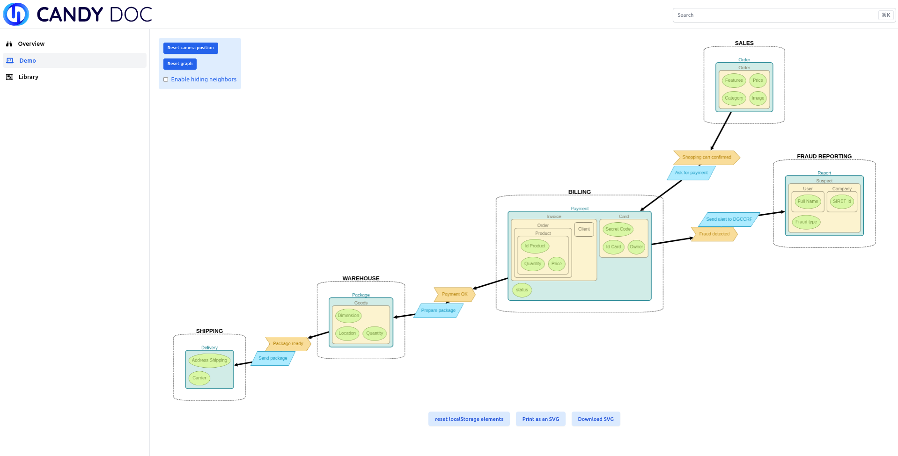

<!-- START doctoc generated TOC please keep comment here to allow auto update -->
<!-- DON'T EDIT THIS SECTION, INSTEAD RE-RUN doctoc TO UPDATE -->
## Table of Contents

- [
  
    
    
    
  
  ✨ Candy Doc Maven plugin ✨
](#-candy-doc-maven-plugin-)
  - [Installation 🚀](#installation-)
    - [With Maven](#with-maven)
- [Usage ‍📝](#usage-‍)
  - [DDD Annotations ✏️](#ddd-annotations-)
    - [Strategic patterns](#strategic-patterns)
    - [Tactical patterns](#tactical-patterns)
  - [Documentation generation 🏗️](#documentation-generation-)
  - [UI Manipulation 🕹️](#ui-manipulation-)
- [Support 🚑](#support-)
- [Roadmap 🗺️](#roadmap-)
  - [References 📚](#references-)
  - [Join us 🙋](#join-us-)
  - [Contributors ✨](#contributors-)
- [License](#license)

<!-- END doctoc generated TOC please keep comment here to allow auto update -->

<h1 align="center">
  <picture>
    <source media="(prefers-color-scheme: dark)" width="242" height="90" alt="CandyDoc logo" srcset="https://user-images.githubusercontent.com/22562938/170952295-d5634b7d-54bf-4beb-a105-50123b29a15b.png">
    <source media="(prefers-color-scheme: light)"width="242" height="90" alt="CandyDoc logo" srcset="https://user-images.githubusercontent.com/22562938/170952293-a3d745d2-c61d-4094-82dd-0e04ea3e0efb.png">
    
  </picture>
  <p>✨ Candy Doc Maven plugin ✨</p>
</h1>

<p align="center">
  <a href="https://mvnrepository.com/artifact/io.candy-doc/candy-doc">
    
  </a>
  <a href="https://github.com/Candy-Doc/candy-doc-components-library/blob/main/LICENSE" alt="License">
    
  </a>
  <a href="https://discord.com/invite/CxwdeKjtcT" alt="Discord link">
    
  </a>
</p>

Candy Doc is a documentation generator plugin for projects built with the
Domain-Driven-Design approach.

> _"Domain-Driven Design is an approach to software development that centers
> the development on programming
> a domain model that has a rich understanding
> of the processes and rules of a domain."_ - Martin Fowler
> [See more](#references)



## Installation 🚀

### With Maven

To run this plugin, import the following in your project **_pom.xml_** :

```xml
<dependency>
    <groupId>io.candy-doc</groupId>
    <artifactId>candy-doc</artifactId>
    <version>${candy-doc.version}</version>
</dependency>

<plugin>
    <groupId>io.candy-doc</groupId>
    <artifactId>candy-doc</artifactId>
    <version>${candy-doc.version}</version>
    <executions>
        <execution>
            <goals>
                <goal>ubiquitous-language</goal>
            </goals>
        </execution>
    </executions>
    <configuration>
        <packagesToScan>
            <packageToScan>com.foo.bar</packageToScan>
        </packagesToScan>
        <outputFormat>json</outputFormat>
    </configuration>
</plugin>
```

Then, specify the configuration parameters:

- **outputFormat:** The output format in which the documentation is generated.
  - Output format can be either `json` or `yml`.
- **packagesToScan:** The chosen packages to scan to generate a documentation for, as shown below :

```xml
<packagesToScan>
    <packageToScan>com.foo.bar.baz</packageToScan>
    <packageToScan>com.foo.qux</packageToScan>
</packagesToScan>
```

# Usage ‍📝

To use the plugin, you need to annotate your project with the DDD annotations described below :

## DDD Annotations ✏️

Domain-Driven-Design concepts are identified with annotations.

### Strategic patterns

Only `package-info.java` files can be annotated with `@BoundedContext` or `@SharedKernel`. Every
other concepts must belong to a strategic pattern.

```java
@BoundedContext(name = "", description = "")

@SharedKernel(name = "", description = "")
```

Nested bounded contexts or nested shared kernels are forbidden and prevented by the plugin when processing classes.

### Tactical patterns

```java
@Aggregate(name = "", description = "")

@DomainCommand(description = "")

@DomainEvent(description = "")

@ValueObject(description = "")
```

## Documentation generation 🏗️

Once your project is correctly annotated with
the [DDD Annotations](#DDD_Annotations), use Maven to run the plugin :

```
mvn clean install
```

A JSON file will be generated in the `target/candy-doc` directory. The next step is the candy-board downloading. Use the following commands :

```
npm i @candy-doc/cli
candy-doc build /target/candy-doc/ubiquitous-language/
```

Those two lines will download the Candy-doc CLI and download the Candy-doc UI called **Candy-board**.

Now, a `candy-build` repository appeared in your root directory.

You can display your documentation by opening the `index.html` file in your favorite browser.

## UI Manipulation 🕹️

Here's some features of Candy-board. Feel free to use them at your convenience.

- Node move
- SVG export
- Focus on direct neighbors (by checking `Enable hiding neigbors`)
- Node position storage
- New graph generation (by clicking `Reset graph`)

# Support 🚑

If you face any issue feel free to create an issue on the GitHub repository or to contact us on our
[Discord server](https://discord.gg/CxwdeKjtcT), join us !


# Roadmap 🗺️

To know on what the team are actually working on, you can see the different
milestones [here](https://github.com/Candy-Doc/candy-doc-maven-plugin/milestones)

## References 📚

- DDD (Martin Fowler):
  <https://martinfowler.com/tags/domain%20driven%20design.html>
- DDD, en vrai pour le développeur (Cyrille Martraire):
  <https://www.youtube.com/watch?v=h3DLKrvp5V8>
- Summary of a 4 days DDD Training (Thomas Ferro):
  <https://thomasferro.medium.com/summary-of-a-four-days-ddd-training-74103a6d99a1>

## Join us 🙋

If you want to get in touch with our community there is a [Discord server](https://discord.gg/CxwdeKjtcT), join us !


## Contributors ✨

- [Contribute to the project](./CONTRIBUTING.md)

Thanks goes to these wonderful people ([emoji key](https://allcontributors.org/docs/en/emoji-key)):

<!-- ALL-CONTRIBUTORS-LIST:START - Do not remove or modify this section -->
<!-- prettier-ignore-start -->
<!-- markdownlint-disable -->
<table>
  <tr>
    <td align="center"><a href="https://github.com/mderoullers"><br /><sub><b>Maxime Deroullers</b></sub></a><br /><a href="https://github.com/Candy-Doc/candy-doc-maven-plugin/pulls?q=is%3Apr+reviewed-by%3Amderoullers" title="Reviewed Pull Requests">👀</a></td>
    <td align="center"><a href="https://ctacquet.com"><br /><sub><b>Charles Tacquet</b></sub></a><br /><a href="https://github.com/Candy-Doc/candy-doc-maven-plugin/commits?author=ctacquet" title="Documentation">📖</a> <a href="https://github.com/Candy-Doc/candy-doc-maven-plugin/issues?q=author%3Actacquet" title="Bug reports">🐛</a> <a href="https://github.com/Candy-Doc/candy-doc-maven-plugin/commits?author=ctacquet" title="Code">💻</a> <a href="#data-ctacquet" title="Data">🔣</a> <a href="#design-ctacquet" title="Design">🎨</a> <a href="#example-ctacquet" title="Examples">💡</a> <a href="#ideas-ctacquet" title="Ideas, Planning, & Feedback">🤔</a> <a href="#question-ctacquet" title="Answering Questions">💬</a> <a href="https://github.com/Candy-Doc/candy-doc-maven-plugin/pulls?q=is%3Apr+reviewed-by%3Actacquet" title="Reviewed Pull Requests">👀</a> <a href="https://github.com/Candy-Doc/candy-doc-maven-plugin/commits?author=ctacquet" title="Tests">⚠️</a></td>
    <td align="center"><a href="https://github.com/ecattez"><br /><sub><b>Edouard CATTEZ</b></sub></a><br /><a href="https://github.com/Candy-Doc/candy-doc-maven-plugin/pulls?q=is%3Apr+reviewed-by%3Aecattez" title="Reviewed Pull Requests">👀</a></td>
    <td align="center"><a href="https://github.com/Tifloz"><br /><sub><b>Tiflo</b></sub></a><br /><a href="#infra-Tifloz" title="Infrastructure (Hosting, Build-Tools, etc)">🚇</a> <a href="https://github.com/Candy-Doc/candy-doc-maven-plugin/commits?author=Tifloz" title="Documentation">📖</a> <a href="https://github.com/Candy-Doc/candy-doc-maven-plugin/pulls?q=is%3Apr+reviewed-by%3ATifloz" title="Reviewed Pull Requests">👀</a> <a href="#tutorial-Tifloz" title="Tutorials">✅</a> <a href="https://github.com/Candy-Doc/candy-doc-maven-plugin/issues?q=author%3ATifloz" title="Bug reports">🐛</a> <a href="#ideas-Tifloz" title="Ideas, Planning, & Feedback">🤔</a> <a href="#maintenance-Tifloz" title="Maintenance">🚧</a> <a href="#question-Tifloz" title="Answering Questions">💬</a> <a href="#platform-Tifloz" title="Packaging/porting to new platform">📦</a></td>
    <td align="center"><a href="https://maji.kiwi"><br /><sub><b>Maji</b></sub></a><br /><a href="https://github.com/Candy-Doc/candy-doc-maven-plugin/commits?author=M4gie" title="Documentation">📖</a> <a href="#ideas-M4gie" title="Ideas, Planning, & Feedback">🤔</a> <a href="https://github.com/Candy-Doc/candy-doc-maven-plugin/pulls?q=is%3Apr+reviewed-by%3AM4gie" title="Reviewed Pull Requests">👀</a></td>
    <td align="center"><a href="https://github.com/Michiels96"><br /><sub><b>Pierre</b></sub></a><br /><a href="https://github.com/Candy-Doc/candy-doc-maven-plugin/commits?author=Michiels96" title="Documentation">📖</a> <a href="#infra-Michiels96" title="Infrastructure (Hosting, Build-Tools, etc)">🚇</a> <a href="https://github.com/Candy-Doc/candy-doc-maven-plugin/pulls?q=is%3Apr+reviewed-by%3AMichiels96" title="Reviewed Pull Requests">👀</a> <a href="#platform-Michiels96" title="Packaging/porting to new platform">📦</a></td>
    <td align="center"><a href="http://www.francois-delbrayelle.fr"><br /><sub><b>François Delbrayelle</b></sub></a><br /><a href="https://github.com/Candy-Doc/candy-doc-maven-plugin/commits?author=fdelbrayelle" title="Documentation">📖</a></td>
  </tr>
  <tr>
    <td align="center"><a href="https://github.com/AVernholles"><br /><sub><b>AVernholles</b></sub></a><br /><a href="https://github.com/Candy-Doc/candy-doc-maven-plugin/commits?author=AVernholles" title="Documentation">📖</a> <a href="https://github.com/Candy-Doc/candy-doc-maven-plugin/commits?author=AVernholles" title="Code">💻</a> <a href="https://github.com/Candy-Doc/candy-doc-maven-plugin/issues?q=author%3AAVernholles" title="Bug reports">🐛</a> <a href="https://github.com/Candy-Doc/candy-doc-maven-plugin/commits?author=AVernholles" title="Tests">⚠️</a> <a href="#ideas-AVernholles" title="Ideas, Planning, & Feedback">🤔</a> <a href="https://github.com/Candy-Doc/candy-doc-maven-plugin/pulls?q=is%3Apr+reviewed-by%3AAVernholles" title="Reviewed Pull Requests">👀</a> <a href="#example-AVernholles" title="Examples">💡</a> <a href="#design-AVernholles" title="Design">🎨</a> <a href="#content-AVernholles" title="Content">🖋</a></td>
    <td align="center"><a href="https://github.com/aginesy"><br /><sub><b>aginesy</b></sub></a><br /><a href="https://github.com/Candy-Doc/candy-doc-maven-plugin/commits?author=aginesy" title="Documentation">📖</a> <a href="https://github.com/Candy-Doc/candy-doc-maven-plugin/commits?author=aginesy" title="Code">💻</a> <a href="https://github.com/Candy-Doc/candy-doc-maven-plugin/issues?q=author%3Aaginesy" title="Bug reports">🐛</a> <a href="https://github.com/Candy-Doc/candy-doc-maven-plugin/commits?author=aginesy" title="Tests">⚠️</a> <a href="#ideas-aginesy" title="Ideas, Planning, & Feedback">🤔</a> <a href="https://github.com/Candy-Doc/candy-doc-maven-plugin/pulls?q=is%3Apr+reviewed-by%3Aaginesy" title="Reviewed Pull Requests">👀</a> <a href="#example-aginesy" title="Examples">💡</a> <a href="#design-aginesy" title="Design">🎨</a> <a href="#content-aginesy" title="Content">🖋</a></td>
    <td align="center"><a href="https://github.com/AntonyDerache"><br /><sub><b>Antony Derache</b></sub></a><br /><a href="https://github.com/Candy-Doc/candy-doc-maven-plugin/commits?author=AntonyDerache" title="Documentation">📖</a> <a href="https://github.com/Candy-Doc/candy-doc-maven-plugin/commits?author=AntonyDerache" title="Code">💻</a> <a href="https://github.com/Candy-Doc/candy-doc-maven-plugin/issues?q=author%3AAntonyDerache" title="Bug reports">🐛</a> <a href="https://github.com/Candy-Doc/candy-doc-maven-plugin/commits?author=AntonyDerache" title="Tests">⚠️</a> <a href="#ideas-AntonyDerache" title="Ideas, Planning, & Feedback">🤔</a> <a href="https://github.com/Candy-Doc/candy-doc-maven-plugin/pulls?q=is%3Apr+reviewed-by%3AAntonyDerache" title="Reviewed Pull Requests">👀</a> <a title="Design">🎨</a> <a title="Content">🖋</a></td>
    <td align="center"><a href="https://github.com/dylanmsql"><br /><sub><b>Dylan Masquelier</b></sub></a><br /><a href="https://github.com/Candy-Doc/candy-doc-maven-plugin/commits?author=dylanmsql" title="Documentation">📖</a> <a href="https://github.com/Candy-Doc/candy-doc-maven-plugin/commits?author=dylanmsql" title="Code">💻</a> <a href="https://github.com/Candy-Doc/candy-doc-maven-plugin/issues?q=author%3Adylanmsql" title="Bug reports">🐛</a> <a href="https://github.com/Candy-Doc/candy-doc-maven-plugin/commits?author=dylanmsql" title="Tests">⚠️</a> <a href="#ideas-dylanmsql" title="Ideas, Planning, & Feedback">🤔</a> <a href="https://github.com/Candy-Doc/candy-doc-maven-plugin/pulls?q=is%3Apr+reviewed-by%3Adylanmsql" title="Reviewed Pull Requests">👀</a> <a title="Design">🎨</a> <a title="Content">🖋</a></td>
    <td align="center"><a href="https://github.com/Yugo-Cartron"><br /><sub><b>Yugo Cartron</b></sub></a><br /><a href="https://github.com/Candy-Doc/candy-doc-maven-plugin/commits?author=Yugo-Cartron" title="Documentation">📖</a> <a href="https://github.com/Candy-Doc/candy-doc-maven-plugin/commits?author=Yugo-Cartron" title="Code">💻</a> 
      <a href="https://github.com/Candy-Doc/candy-doc-maven-plugin/issues?q=author%3AYugo-Cartron" title="Bug reports">🐛</a> 
      <a href="https://github.com/Candy-Doc/candy-doc-maven-plugin/commits?author=Yugo-Cartron" title="Tests">⚠️</a> 
      <a title="Ideas, Planning, & Feedback">🤔</a> 
      <a href="https://github.com/Candy-Doc/candy-doc-maven-plugin/pulls?q=is%3Apr+reviewed-by%3AYugo-Cartron" title="Reviewed Pull Requests">👀</a>
      <a title="Design">🎨</a> 
      <a title="Content">🖋</a></td>
    <td align="center"><a href="https://github.com/monxxi"><br /><sub><b>Kevin Prevost</b></sub></a><br /><a href="https://github.com/Candy-Doc/candy-doc-maven-plugin/pulls?q=is%3Apr+reviewed-by%3Amonxxi" title="Reviewed Pull Requests">👀</a</td>
  </tr>
</table>

<!-- markdownlint-restore -->
<!-- prettier-ignore-end -->

<!-- ALL-CONTRIBUTORS-LIST:END -->

This project follows the [all-contributors](https://github.com/all-contributors/all-contributors) specification.
Contributions of any kind welcome!

[Contributing to the project]: CONTRIBUTING.md

# License

[GPL-3](./LICENCE)
